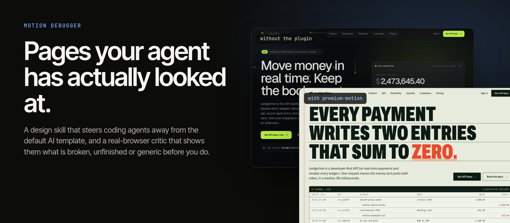
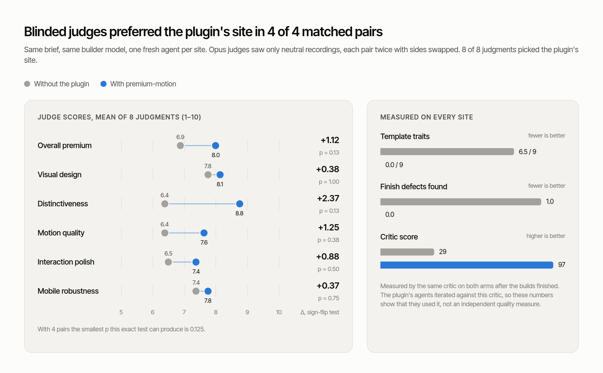
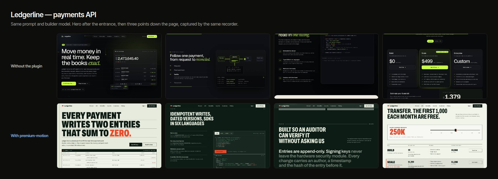
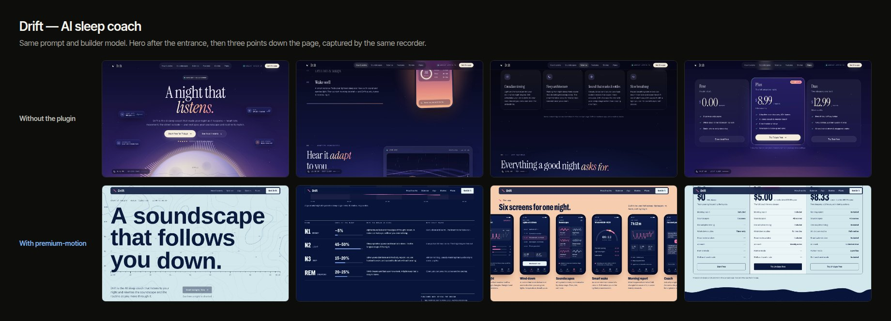
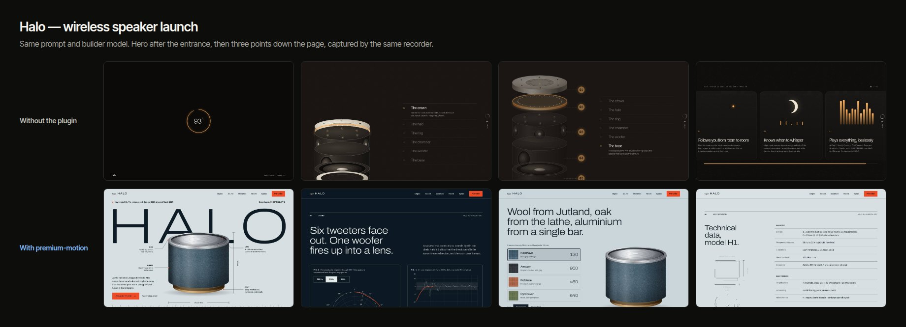
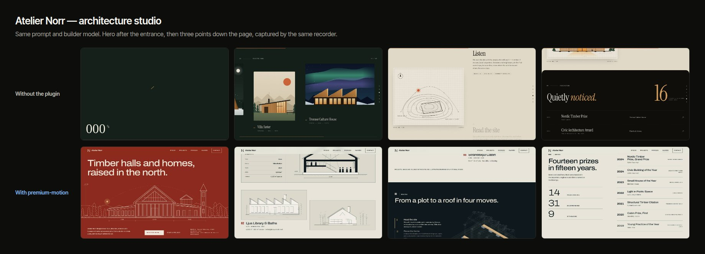
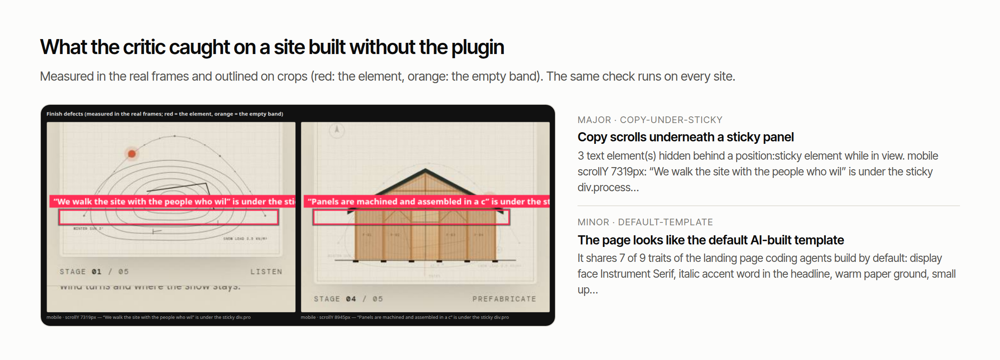

<p align="center">
  
</p>

<p align="center">
  
  
  
</p>

<p align="center"><b>Pages your agent has actually looked at.</b></p>

<p align="center">
  <a href="#quickstart">Quickstart</a> · <a href="#results">Results</a> · <a href="#what-the-critic-sees">The critic</a> · <a href="#coding-agents">Coding agents</a> · <a href="docs/PREMIUM-MOTION.md">Documentation</a>
</p>



Coding agents asked for a "premium" site all build the same one: a condensed serif with an italic accent word, a near-black ground, an eyebrow over a left-hand headline, pill buttons, a marquee and a bento grid. They also never see what they shipped, so it goes out with empty bands, half-filled cards and copy hidden under sticky panels.

Motion Debugger fixes both, in any agent:

- **`premium-motion` skill.** Names that default page and makes the agent leave it, takes art direction from the brief's own world, and sets a finish system and one finished signature scroll scene. A dependency-free motion kit supplies the scroll scenes, reveals and hover states as data attributes.
- **`motion-debugger critique`.** Opens the page in Chromium at desktop and mobile, records the entrance, a full scroll, hovers, keyboard focus and reduced motion, and returns findings with fixes. Finish defects come outlined on crops of the real frames, with a count of how many default-template traits the page shares.

```sh
motion-debugger critique ./site                   # a folder with index.html, or an .html file
motion-debugger critique http://127.0.0.1:5173    # a running local dev server
motion-debugger agents-md >> AGENTS.md            # standing instructions for any agent host
```

The recorded-evidence tools for debugging one transition (`motion_review`, `motion_probe`, `motion_capture` and others) remain available. See [How it works](#how-it-works).

## Quickstart

Requires **Node.js 22+** and Chromium. This is an unpublished local preview, so install from GitHub rather than npm.

```sh
git clone https://github.com/ShadowKingYT444/motion-debugger.git
cd motion-debugger
npm ci && npm run build
npm install -g .                       # puts `motion-debugger` on your PATH
motion-debugger setup --browser        # explicit, version-matched Chromium download
motion-debugger doctor
```

To skip the global install, run `node build/cli/index.js <command>` instead of `motion-debugger`. An existing Chrome or Chromium also works: set `CHROMIUM_PATH`, or let the CLI find `/usr/bin/google-chrome` or `/usr/bin/chromium`.

Critique any local page straight away:

```sh
motion-debugger critique ./path/to/site    # prints findings and writes contact sheets to .motion-critique/
```

Connect it to your application project:

```sh
motion-debugger init --client codex --local --skills \
  --project /absolute/path/to/your-app
```

The command previews the MCP configuration and skill files. Review it, then rerun with `--apply` to confirm in an interactive terminal. For scripts, add `--apply --confirm <confirmationToken>` from that exact preview. Keep this checkout in place: `--local` registers its absolute runtime path. Unrelated settings and skill files are preserved.

For a portable installation, run `npm pack`, then install the resulting tarball in a stable tools directory. [Installation details](docs/CLIENTS.md).

## Results

Same prompt, same builder model (Sonnet 5.5), one fresh agent per site. One agent worked in an empty project; the other had the skill, the kit and the critic. Nothing was edited by hand.

<picture>
  <source media="(prefers-color-scheme: dark)" srcset="docs/assets/results-dark.png">
  
</picture>

In the latest batch (plugin v4, four matched pairs), blinded Opus 5.5 judges chose the plugin's site in all 8 judgments. Distinctiveness rose from 6.4 to 8.8 and overall premium from 6.9 to 8.0. The control sites shared 6.5 of 9 default-template traits on average; the plugin's sites shared none. Visual design moved least (7.8 to 8.1).

Four pairs cannot reach statistical significance: the smallest p an exact test can give is 0.125. The earlier 16-pair study (plugin v1–v2) did reach it for overall premium (+1.0, p = 0.005) and motion quality (+1.34, p = 0.0004), but found no gain in visual design, which is what v4 was rebuilt to address. [Method, every verdict and threats to validity](studies/premium-ab/README.md).

**Ledgerline: payments API**



**Drift: AI sleep coach**



**Halo: wireless speaker launch**



**Atelier Norr: architecture studio**



Watch them move: each pair has a side-by-side film of the same scripted visit ([Ledgerline](demos/ledgerline/comparison.mp4), [Drift](demos/drift/comparison.mp4), [Halo](demos/halo/comparison.mp4), [Norr](demos/norr/comparison.mp4)), and `motion-debugger demo` opens every site live.


## What the critic sees

<picture>
  <source media="(prefers-color-scheme: dark)" srcset="docs/assets/critic-dark.png">
  
</picture>

Beyond motion and accessibility lint, the critic measures finish in the frames it captured:

| Finding | What it catches |
| --- | --- |
| `text-collision`, `copy-under-sticky` | Copy painted over other copy, or scrolling under a sticky panel |
| `hollow-containers`, `dead-space` | Cards with an empty band inside; screens where over half the height is blank |
| `near-miss-alignment`, `edge-crowding` | Items a few pixels off their column; copy against the screen edge |
| `shrunken-text`, `double-spaced-code`, `clipped-code` | A scale that never finished; code with a blank line between lines or cut off |
| `default-template` | How many of nine default AI-landing-page traits the first screen shares |

Each run also reports what changed since the previous critique of the same page: findings fixed, new findings and how many remain. [All checks and limits](docs/PREMIUM-MOTION.md).

## Coding agents

Replace `codex` in the setup command with your client:

| Agent | `--client` | Project MCP configuration | Skills |
| --- | --- | --- | --- |
| Codex | `codex` | `.codex/config.toml` | `.agents/skills/` |
| Claude Code | `claude-code` | `.mcp.json` | `.claude/skills/` |
| Cursor | `cursor` | `.cursor/mcp.json` | `.cursor/skills/` |
| VS Code / Copilot | `vscode` | `.vscode/mcp.json` | `.github/skills/` |
| OpenCode 1.x | `opencode` | `opencode.json` | `.opencode/skills/` |

Reload your agent after installation and check that Motion's MCP tools are connected. OpenCode v2 uses a different configuration format; see [client setup](docs/CLIENTS.md#opencode). Native plugin package options are in the [plugin guide](docs/PLUGIN-PACKAGES.md).

**Any other agent** (Gemini CLI, Aider, Copilot agent, Windsurf, a CI job) needs nothing provider-specific:

1. Copy `plugin/motion-debugger/skills/premium-motion` anywhere in the project.
2. Add the block printed by `motion-debugger agents-md --skills-dir <that folder>` to the host's standing-instructions file (`AGENTS.md`, `GEMINI.md`, `.cursorrules`, …).
3. Let it run `motion-debugger critique`. The critic is a plain CLI with Markdown or `--json` output and image files.

MCP hosts also get `motion_critique`, which returns the findings and contact sheets as image content. Details are in [Premium motion: skill + critic](docs/PREMIUM-MOTION.md).

Example prompt for any agent:

> Build a launch page for our speaker with premium design and motion. Follow the premium-motion skill, and critique the page before you finish.

## How it works

1. **Direct.** The skill names the default page, has the agent change at least four of its defaults, and takes type, colour and layout decisions from three artefacts of the subject's world.
2. **Compose and finish.** One dominant element per frame, sections laid out from their content, shared edges, boxes sized to content, hover that shows in a still, and a real phone layout.
3. **Move.** One motion personality, a written motion score, a choreographed hero, and one signature scroll scene finished at every scroll position, with at most two supporting scenes. The kit handles the mechanics with reduced-motion and no-JS fallbacks.
4. **Look.** `critique` records what actually moved and measures finish in the captured frames. `craft.png` outlines each defect; detail sheets show type and spacing at a readable size.
5. **Refine.** The agent fixes every outlined defect, answers five design-director questions about each frame, and critiques again. The score is a lint, not the stop condition.

For a specific interaction, the evidence tools record bounded journeys and compare repairs:

| Tool | Purpose |
| --- | --- |
| `motion_critique` | Critique a whole page: findings, fixes and contact sheets |
| `motion_recipe` | Get runnable animation patterns and integration guidance |
| `motion_review` | Review transitions with actor observations and native images |
| `motion_probe` | Try interruption offsets and retain failure evidence |
| `motion_capture` | Record a local interaction with explicit expectations |
| `motion_inspect` | Inspect events and measurements around a moment |
| `motion_frames` | Extract images from the actual recording |
| `motion_compare` | Compare equivalent before/after journeys |
| `motion_list` | Find saved captures |

Recordings and reports stay local in `.motion-evidence/`. Capture trusted, credential-free local pages. Measurements check your stated contracts; visual taste remains a human judgment.

## Demos

```sh
motion-debugger demo
```

Open **http://127.0.0.1:4173/ab/** to play the four comparison films and open every agent-built site live. The root URL has the original transition-debugging examples. The sites and films are also in [`demos/`](demos/README.md); `npm run demo:record` re-records the films from the committed sites.

[Premium motion](docs/PREMIUM-MOTION.md) · [Agent workflow](docs/AGENT-WORKFLOW.md) · [Skills](docs/SKILLS.md) · [Contributing](CONTRIBUTING.md) · [Security](SECURITY.md)
