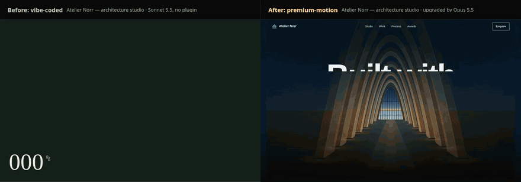
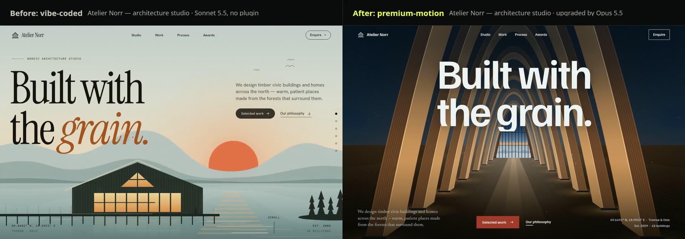
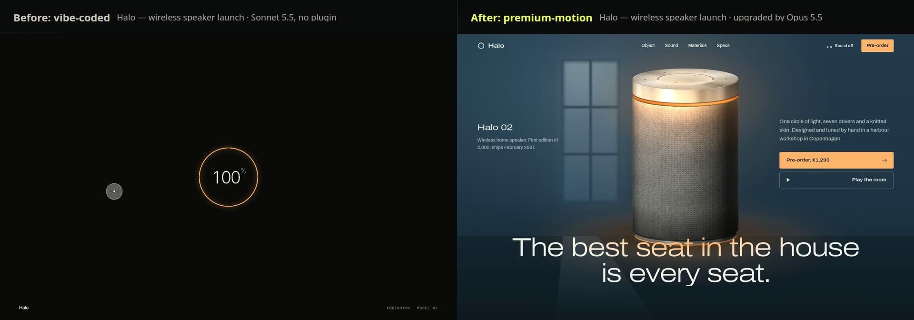
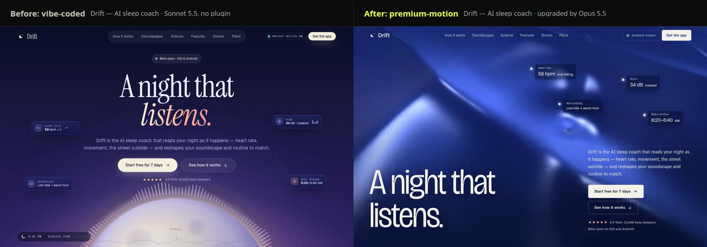
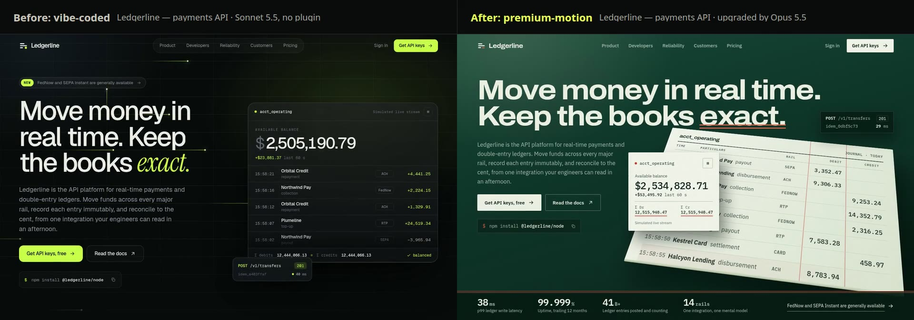

<p align="center">
  
</p>

<h3 align="center">Upgrade a vibe-coded site to premium with your coding agent.<br>Motion first, then taste, checked in a real browser.</h3>

<p align="center">
  <a href="https://github.com/ShadowKingYT444/motion-debugger/actions/workflows/ci.yml"></a>
  <a href="LICENSE"></a>
  
  
</p>

<p align="center">
  <a href="#install">Install</a> ·
  <a href="#upgrade-a-site">Upgrade a site</a> ·
  <a href="#commands">Commands</a> ·
  <a href="#the-critic">The critic</a> ·
  <a href="#four-upgrades">Demos</a> ·
  <a href="#faq">FAQ</a> ·
  <a href="CONTRIBUTING.md">Contribute</a>
</p>

<p align="center">
  
  <br><sub>Left: a site an agent built from a one-paragraph brief. Right: the same site after a fresh agent (Opus 5.5) ran <code>premium-motion upgrade</code> on it. Nothing edited by hand. <a href="#four-upgrades">All four upgrades</a>.</sub>
</p>

Every agent-built landing page looks the same: near-black with one neon accent, a headline with an italic word, pill buttons, a bento grid, a logo marquee, and every section fading up the same way. It is not ugly. It just tells everyone a model made it, and nobody looked at it before it shipped.

Motion Debugger gives your agent two things it doesn't have:

- 🎬 **A workflow that rebuilds the look and keeps the truth.** The `premium-motion` skill runs an `upgrade` pipeline: it records a baseline, keeps every fact, link and form, picks a direction from the product's own world, then rebuilds the page around choreographed motion and one cinematic scroll scene. It uses a tested GSAP, ScrollTrigger, SplitText and Lenis stack, or Motion in React projects.
- 👀 **Eyes.** `motion-debugger critique` opens the local page in Chromium, records the entrance, scrolls the whole page, hovers every control, checks the phone layout and reduced motion, and hands the agent ranked fixes plus screenshots of the real frames. The agent looks, fixes and looks again, then compares against the baseline.

## Install

Every line below is one command. They work with any model and any coding agent, and the same commands run on macOS, Linux and Windows (bash, zsh or PowerShell). The CLI and `npx` lines need Node.js 22 or later; the git line needs only git.

**The full setup** (critic, skill and agent configuration). Install, then run `init` in your project:

```bash
npm install -g https://github.com/ShadowKingYT444/motion-debugger/releases/latest/download/motion-debugger.tgz
```

```bash
motion-debugger init
```

`init` detects your agent (Claude Code, Cursor, Codex, VS Code, OpenCode), installs the skill, offers to download a matching Chromium, and shows every file it would change before asking you to type `yes`. Nothing is written without that, and your existing settings are kept.

**Just the skill, or just the critic:**

| You want | One line |
| --- | --- |
| The skill, for the agent you use | `npx skills add ShadowKingYT444/motion-debugger --skill premium-motion -a cursor` |
| The skill, in the shared `.agents/skills` folder many agents read | `npx skills add ShadowKingYT444/motion-debugger --skill premium-motion -a universal -y` |
| The skill without Node (bash, zsh) | `mkdir -p .agents/skills && git clone --depth 1 https://github.com/ShadowKingYT444/motion-debugger.git /tmp/motion-debugger && cp -r /tmp/motion-debugger/plugin/motion-debugger/skills/premium-motion .agents/skills/` |
| The skill without Node (PowerShell) | `git clone --depth 1 https://github.com/ShadowKingYT444/motion-debugger.git $env:TEMP\motion-debugger; $null = New-Item -ItemType Directory -Force .agents\skills; Copy-Item -Recurse $env:TEMP\motion-debugger\plugin\motion-debugger\skills\premium-motion .agents\skills\` |
| The critic, with nothing installed | `npx -y -p https://github.com/ShadowKingYT444/motion-debugger/releases/latest/download/motion-debugger.tgz motion-debugger critique http://localhost:3000` |
| A browser for the critic | `motion-debugger setup --browser` |

For `-a`, use your agent's name: `claude-code`, `cursor`, `codex`, `gemini-cli`, `github-copilot`, `windsurf`, `cline`, `roo`, `zed`, `opencode`, `goose`, `kiro-cli`, `amp`, `junie` and about 70 more ([skills CLI](https://github.com/vercel-labs/skills)). An agent that can't run shell commands can still follow the skill; it just can't look at the page.

The critic uses Playwright's Chromium if you downloaded it, then `CHROMIUM_PATH`, then an installed Chrome, Chromium or Edge in the usual place on macOS, Windows or Linux. CI installs the packed CLI on all three and critiques a real page.

<details>
<summary><b>Installing from source?</b></summary>

```bash
git clone https://github.com/ShadowKingYT444/motion-debugger.git
cd motion-debugger && npm ci && npm run build && npm install -g .
motion-debugger setup --browser    # version-matched Chromium
motion-debugger doctor
```

More options in [client setup](docs/CLIENTS.md).
</details>

## Upgrade a site

Start your dev server, then tell your agent:

> Use premium-motion upgrade on this site.

What the agent does, from [`commands/upgrade.md`](plugin/motion-debugger/skills/premium-motion/commands/upgrade.md):

1. **Baseline.** Critiques the page as it is and lists its AI tells.
2. **Inventory.** Writes down what to keep (facts, numbers, CTAs, forms, your logo and colours) and what to replace.
3. **Direction.** Writes `PREMIUM.md`: audience, facts, the product's world, type, colour, imagery and one motion personality.
4. **First viewport.** Rebuilds the hero alone and critiques it until it holds up.
5. **Rebuild.** Works section by section, each laid out from its content instead of eyebrow, bento and marquee.
6. **Signature scene.** Builds one scroll-scrubbed scene that tells the product's story and is finished at every scroll position.
7. **Polish and harden.** Fixes every outlined defect, then the phone layout, reduced motion, accessibility and scroll performance.
8. **Verify.** Critiques again and compares with the baseline side by side.

Narrow targets work too: `upgrade the pricing section`, `signature the how-it-works section`, `polish the footer`.

## Commands

| Command | What it does |
| --- | --- |
| `upgrade [target]` | The full pipeline above: vibe-coded to premium, verified before and after |
| `audit [target]` | Records the page and ranks every AI tell and motion or finish defect. No edits |
| `direction` | Writes `PREMIUM.md`, the design context every other command reads |
| `motion [target]` | Choreographs the hero, reveals, hover, press and transitions in one personality |
| `signature [target]` | Designs and builds one cinematic scroll scene |
| `typeset [target]` | Replaces default type with a system that has character, scale and finish |
| `palette [target]` | Colour, light and depth from the product's world, with a chapter rhythm |
| `imagery [target]` | Rich visuals without stock photos: product renders, generative scenes, live product UI |
| `compose [target]` | Layout, hierarchy and rhythm: one dominant element per frame |
| `polish [target]` | The finish pass: everything the critic outlines, every state, every edge |
| `harden [target]` | Phone layout, reduced motion, accessibility and scroll performance |

The motion code agents copy from the skill is extracted from its Markdown and run in Chromium in CI at desktop, phone and reduced-motion sizes, so the documented snippet is the tested snippet.

## The critic

Run it yourself on anything local:

```bash
motion-debugger critique http://localhost:3000   # your dev server (Next.js, Vite, …)
motion-debugger critique ./site                  # a folder with index.html, or one .html file
```

It prints findings with fixes, writes contact sheets to `.motion-critique/`, and says what changed since the last run: fixed, new and remaining.

It runs headless by default, so it works in CI as it is. `--fail-on blocker` exits with code 2 when a finding is that severe, `--github` prints the findings as GitHub Actions annotations, and `--open` shows the first image when you run it yourself. [Options and a workflow example](docs/PREMIUM-MOTION.md#options).

<picture>
  <source media="(prefers-color-scheme: dark)" srcset="docs/assets/critic-dark.png">
  
</picture>

| | Finding | What it means |
| --- | --- | --- |
| 🎞️ | Motion checks | No entrance, unstaggered entrance, linear easing, motion that stops after the hero, dead hover, invisible focus, no reduced-motion support, scroll jank, layout shift |
| 🚫 | `stuck-invisible` | Content that never appears, even after a full scroll (the most common agent bug) |
| 🧱 | `text-collision`, `copy-under-sticky` | Copy painted over other copy, or scrolling under a sticky header |
| 🕳️ | `hollow-containers`, `dead-space` | Cards with an empty band inside; screens that are mostly blank |
| 📐 | `near-miss-alignment`, `edge-crowding` | Items a few pixels off their column; copy jammed against the screen edge |
| 📱 | `mobile-overflow`, tap targets, clipped text | A phone layout that is really a squeezed desktop |
| 🤖 | `default-template` | How many of nine default AI-landing-page traits the first screen shares |

Findings come from real Chromium frames, never from reading the source. [Every check and its limits](docs/PREMIUM-MOTION.md).

## Four upgrades

Four landing pages that Sonnet 5.5 built from one-paragraph briefs with no plugin, the controls from the A/B study below. A fresh Opus 5.5 agent ran `upgrade` on each, with the same prompt. These are single runs to show the workflow, not a blinded comparison, and nobody edited the results. The prompt, the skill version and every recording are in [`demos/upgrades.json`](demos/upgrades.json).

| | Critic score before → after | Blocker and major findings | Template traits |
| --- | --- | --- | --- |
| Ledgerline: payments API | 30 → 100 | 2 → 0 | 6 → 1 of 9 |
| Atelier Norr: architecture studio | 8 → 98 | 4 → 0 | 7 → 0 of 9 |
| Halo: wireless speaker launch | 38 → 100 | 3 → 0 | 5 → 0 of 9 |
| Drift: AI sleep coach | 24 → 100 | 3 → 0 | 8 → 0 of 9 |

One critic run per site, made after the agents finished. The agents were working against this critic, so read the score as "the defects it can see are gone", not as a measure of taste. Judge the films.

**Atelier Norr: architecture studio** · [film](demos/norr/upgrade.mp4)


**Halo: wireless speaker launch** · [film](demos/halo/upgrade.mp4)


**Drift: AI sleep coach** · [film](demos/drift/upgrade.mp4)


**Ledgerline: payments API** · [film](demos/ledgerline/upgrade.mp4)


Each `upgraded/` folder also holds the `PREMIUM.md` direction file the agent wrote. Open any site live from [`demos/`](demos/README.md).

## Does it work? The blinded study

Separately from the upgrades, we ran a blinded A/B test of building from scratch: same brief, same builder model (Sonnet 5.5), one fresh agent per site. One agent worked in an empty project; the other had the skill and the critic.

<picture>
  <source media="(prefers-color-scheme: dark)" srcset="docs/assets/results-dark.png">
  
</picture>

In the latest batch (four matched pairs, plugin v4), blinded Opus 5.5 judges preferred the plugin's site in all four pairs (8 of 8 judgments). Distinctiveness rose from 6.4 to 8.8 and overall premium from 6.9 to 8.0. The control sites shared 6.5 of 9 default-template traits on average; the plugin's sites shared none. Visual design moved least (7.8 to 8.1).

Four pairs are too few for statistical significance. The earlier 16-pair study reached it for overall premium (+1.0, p = 0.005) and motion quality (+1.34, p = 0.0004), but found no gain in visual design, which later versions were rebuilt to address. The study predates the `upgrade` workflow. [Method, every verdict and threats to validity](studies/premium-ab/README.md).

## FAQ

**How is this different from Impeccable or other design skills?** The skill's shape (one skill, a command vocabulary, a context file and a playbook per command) is borrowed from [Impeccable](https://github.com/pbakaus/impeccable), with thanks. The differences are the focus and the loop. Motion is the core: a tested GSAP and Lenis stack, signature scroll scenes, choreography and reduced-motion handling. And every command ends by recording the page in a real browser: the critic measures what actually moved and finds finish defects in the captured frames, so the agent works from evidence instead of reading its own CSS.

**Will it change my content?** `upgrade` keeps the product's facts, numbers, links, forms and anything you already own (logo, brand colours, fonts, photos). It replaces the generic look. Run `audit` first if you only want a report.

**Does it work with my stack?** Plain HTML, React, Next.js, Vite, Motion (framer-motion) and GSAP. The skill uses the animation library you already have and never adds a second one.

**Does it need Claude, or a particular model?** No. Nothing here calls a model API: the critic is a plain CLI with Markdown or `--json` output, and the skill is a standard Agent Skill in Markdown. Use it with any model your agent runs. The demos were made with Claude models because that's what we had; the workflow doesn't depend on them. `init` sets up Claude Code, Cursor, Codex, VS Code and OpenCode, and the skills CLI covers about 80 more agents (see Install).

**Does it work on my machine?** Yes on macOS, Linux and Windows with Node.js 22 or later. CI installs the packed CLI on all three and critiques a real page.

**Does anything leave my machine?** No. The critic only opens credential-free local pages (`localhost`, `127.0.0.1`, files), never imports your browser profile, and keeps recordings in your project folder. [Security model](SECURITY.md).

## Works with your agent

`motion-debugger init` sets these up for you; this is what it writes.

| Agent | `--client` | MCP configuration | Skills |
| --- | --- | --- | --- |
| Claude Code | `claude-code` | `.mcp.json` | `.claude/skills/` |
| Cursor | `cursor` | `.cursor/mcp.json` | `.cursor/skills/` |
| Codex | `codex` | `.codex/config.toml` | `.agents/skills/` |
| VS Code / Copilot | `vscode` | `.vscode/mcp.json` | `.github/skills/` |
| OpenCode 1.x | `opencode` | `opencode.json` | `.opencode/skills/` |

**Any other agent** (Gemini CLI, Aider, Windsurf, a CI job): copy the skill folder into your project and add the block printed by `motion-debugger agents-md --skills-dir <folder>` to the agent's instructions file (`AGENTS.md`, `GEMINI.md`, `.cursorrules`, …).

MCP hosts also get `motion_critique`, which returns the findings and screenshots as image content. [Client setup details](docs/CLIENTS.md) · [Native plugin packages](docs/PLUGIN-PACKAGES.md).

<details>
<summary><b>Debugging one specific transition?</b> The evidence tools.</summary>

For a single interaction, the MCP evidence tools record bounded journeys and compare repairs:

| Tool | Purpose |
| --- | --- |
| `motion_critique` | Critique a whole page: findings, fixes and contact sheets |
| `motion_recipe` | Get runnable animation patterns and integration guidance |
| `motion_review` | Review transitions with actor observations and native images |
| `motion_probe` | Try interruption offsets and retain failure evidence |
| `motion_capture` | Record a local interaction with explicit expectations |
| `motion_inspect` | Inspect events and measurements around a moment |
| `motion_frames` | Extract images from the actual recording |
| `motion_compare` | Compare equivalent before/after journeys |
| `motion_list` | Find saved captures |

See [Agent workflow](docs/AGENT-WORKFLOW.md).
</details>

## Contributing

Bug reports, false positives the critic flags, and new checks are all welcome. Browse the [open issues](https://github.com/ShadowKingYT444/motion-debugger/issues) or say hi in [Discussions](https://github.com/ShadowKingYT444/motion-debugger/discussions). [Contributing guide](CONTRIBUTING.md).

## License

[MIT](LICENSE)
