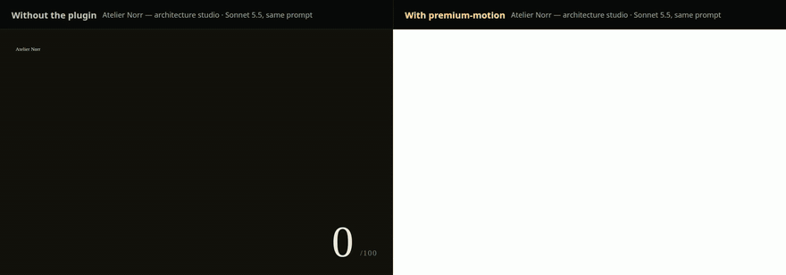
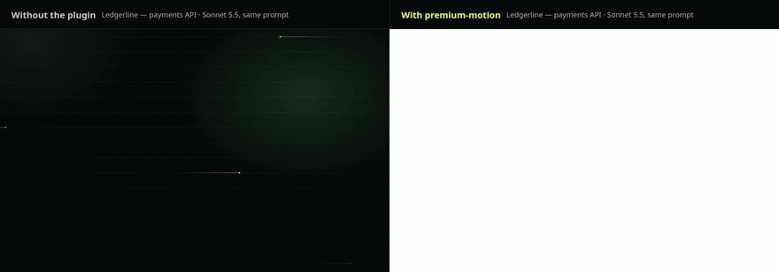
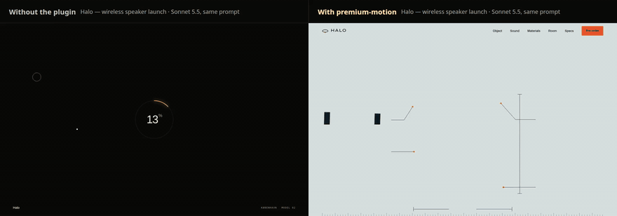
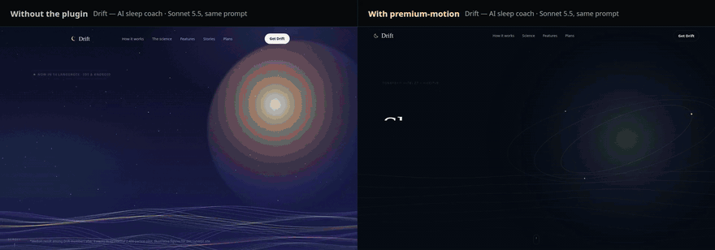

<p align="center">
  
</p>

<p align="center">
  
  
  
</p>

<p align="center"><b>Build motion. Watch it. Make it better.</b></p>

<p align="center">
  <a href="#quickstart">Quickstart</a> · <a href="studies/premium-ab/README.md">A/B results</a> · <a href="#coding-agents">Coding agents</a> · <a href="#how-it-works">How it works</a> · <a href="docs/AGENT-WORKFLOW.md">Documentation</a>
</p>


Motion Debugger helps coding agents ship **premium, art-directed websites with high-quality motion**, and makes them look at the real result. It has two parts that work in any agent:

- **`premium-motion` skill.** A taste guide plus concrete craft guidance. The agent picks one motion personality, writes a motion score for every chapter, and meets an ambition floor: a layered hero that exits on scroll, scrubbed scroll scenes, chapter colour transitions, kinetic type, a living visual and tactile micro-interactions. A dependency-free motion kit turns those into data attributes: pinned stories, horizontal tracks, stacking cards, expanding media, reading highlights, path drawing, scramble type, velocity skew, magnetic and spotlight effects.
- **`motion-debugger critique`.** Opens the page in Chromium at desktop and mobile and records the entrance, a full scroll, hovers, keyboard focus and reduced motion. It returns findings with specific fixes, plus contact sheets the agent reads to *see* its own page.

**Measured effect:** in a blinded 16-pair A/B, agents with the plugin built sites that judges rated more premium in 12 of 16 pairs, with significantly better motion and mobile robustness. [Watch the side-by-side films](#results).

```sh
motion-debugger critique ./site                   # a folder with index.html, or an .html file
motion-debugger critique http://127.0.0.1:5173    # a running local dev server
motion-debugger agents-md >> AGENTS.md            # standing instructions for any agent host
```

The recorded-evidence tools for detailed transition debugging (`motion_review`, `motion_probe`, `motion_capture`, and others) remain available. See [How it works](#how-it-works).

## Quickstart

Requires **Node.js 22+** and Chromium. This is an unpublished local preview, so install from GitHub rather than npm.

```sh
git clone https://github.com/ShadowKingYT444/motion-debugger.git
cd motion-debugger
npm ci && npm run build
npm install -g .                       # puts `motion-debugger` on your PATH
motion-debugger setup --browser        # explicit, version-matched Chromium download
motion-debugger doctor
```

To skip the global install, run `node build/cli/index.js <command>` instead of `motion-debugger`. An existing Chrome or Chromium also works: set `CHROMIUM_PATH`, or let the CLI find `/usr/bin/google-chrome` or `/usr/bin/chromium`.

Critique any local page straight away:

```sh
motion-debugger critique ./path/to/site    # prints findings and writes contact sheets to .motion-critique/
```

Connect it to your application project:

```sh
motion-debugger init --client codex --local --skills \
  --project /absolute/path/to/your-app
```

The command previews the MCP configuration and skill files. Review it, then rerun with `--apply` to confirm in an interactive terminal. For scripts, add `--apply --confirm <confirmationToken>` from that exact preview. Keep this checkout in place: `--local` registers its absolute runtime path. Unrelated settings and skill files are preserved.

For a portable installation, run `npm pack`, then install the resulting tarball in a stable tools directory. [Installation details](docs/CLIENTS.md).

## Results

Same prompt, same builder model (Sonnet 5.5), one fresh agent per site. Left: an empty project. Right: the `premium-motion` skill, taste guide, kit and critic. Each film is the same scripted visit recorded in Chromium: the entrance, a pointer sweep, then a wheel scroll at constant speed. Playback is 1.6× for the preview.

**Atelier Norr: architecture studio**



**Ledgerline: payments API**



**Halo: wireless speaker launch**



**Drift: AI sleep coach** (the one pair where judges preferred the control)



Full-length MP4 films and every site are in [`demos/`](demos/README.md); run `motion-debugger demo` to open them live.

### Blinded judging

Opus 5.5 judges compared each matched pair twice with positions swapped. They saw only neutral recordings and no code, arm labels or critic output.

| Judged on (1–10) | 16 pairs, plugin v1–v2: Δ | p | 4 filmed pairs, v3 with taste guide: Δ |
| --- | --- | --- | --- |
| Overall premium feel | **+1.0** (12 pairs won / 2 lost) | 0.005 | +0.88 (3 / 1) |
| Motion quality | **+1.34** (14 / 1) | 0.0004 | +1.50 |
| Mobile robustness | **+1.0** (9 / 3) | 0.02 | +1.25 |
| Interaction polish | +0.34 | 0.36 | +1.50 |
| Visual design | +0.34 | 0.07 | +0.13 |

Every control site in the 16-pair study had at least one blocker or major defect that the critic flags: content that never appears, reduced-motion visitors losing content, mobile overflow, layout shift, low contrast or controls with no hover feedback. No plugin site did. Four pairs are too few for significance on their own; the filmed batch illustrates the effect rather than proving it independently.

[Method, statistics, threats to validity and every verdict](studies/premium-ab/README.md)

## Coding agents

Replace `codex` in the setup command with your client:

| Agent | `--client` | Project MCP configuration | Skills |
| --- | --- | --- | --- |
| Codex | `codex` | `.codex/config.toml` | `.agents/skills/` |
| Claude Code | `claude-code` | `.mcp.json` | `.claude/skills/` |
| Cursor | `cursor` | `.cursor/mcp.json` | `.cursor/skills/` |
| VS Code / Copilot | `vscode` | `.vscode/mcp.json` | `.github/skills/` |
| OpenCode 1.x | `opencode` | `opencode.json` | `.opencode/skills/` |

Reload your agent after installation and check that Motion's MCP tools are connected. OpenCode v2 uses a different configuration format; see [client setup](docs/CLIENTS.md#opencode). Native plugin package options are in the [plugin guide](docs/PLUGIN-PACKAGES.md).

**Any other agent** (Gemini CLI, Aider, Copilot agent, Windsurf, a CI job) needs nothing provider-specific:

1. Copy `plugin/motion-debugger/skills/premium-motion` anywhere in the project.
2. Add the block printed by `motion-debugger agents-md --skills-dir <that folder>` to the host's standing-instructions file (`AGENTS.md`, `GEMINI.md`, `.cursorrules`, …).
3. Let it run `motion-debugger critique`. The critic is a plain CLI with Markdown or `--json` output and image files.

MCP hosts also get `motion_critique`, which returns the findings and contact sheets as image content. Details are in [Premium motion: skill + critic](docs/PREMIUM-MOTION.md).

Example prompt for any agent:

> Build a launch page for our speaker with premium design and motion. Follow the premium-motion skill, and critique the page before you finish.

## How it works

1. **Art-direct.** The skill makes the agent commit to an audience, a concept, one signature moment, a palette and type before writing code.
2. **Build with a system.** One motion personality, a written motion score, motion tokens, a choreographed hero, at least two different scrubbed scroll scenes, chapter transitions, and hover/press/focus states on every control. The kit handles reveals, split and scrambled text, counters, pinned progress, horizontal tracks, stacking cards, expanding media, reading highlights, path drawing, chapter themes, scroll velocity, parallax, magnetic, spotlight and marquee effects, all with reduced-motion and no-JS fallbacks.
3. **Look.** `critique` records what actually moved and how it was eased and staggered. It checks whether motion reaches every section, whether controls answer hover and focus, and whether anything stays invisible, overflows on mobile, lacks contrast or janks. The contact sheets show the real page.
4. **Refine.** The agent fixes blockers first, then the biggest visible craft gap, and critiques again (at least two passes).

For a specific interaction, the evidence tools record bounded journeys and compare repairs:

| Tool | Purpose |
| --- | --- |
| `motion_critique` | Critique a whole page: findings, fixes and contact sheets |
| `motion_recipe` | Get runnable animation patterns and integration guidance |
| `motion_review` | Review transitions with actor observations and native images |
| `motion_probe` | Try interruption offsets and retain failure evidence |
| `motion_capture` | Record a local interaction with explicit expectations |
| `motion_inspect` | Inspect events and measurements around a moment |
| `motion_frames` | Extract images from the actual recording |
| `motion_compare` | Compare equivalent before/after journeys |
| `motion_list` | Find saved captures |

Recordings and reports stay local in `.motion-evidence/`. Capture trusted, credential-free local pages. Measurements check your stated contracts; visual taste remains a human judgment.

## Demos

```sh
motion-debugger demo
```

Open **http://127.0.0.1:4173/ab/** to play the four comparison films and open every agent-built site live. The root URL has the original transition-debugging examples. The sites and films are also in [`demos/`](demos/README.md); `npm run demo:record` re-records the films from the committed sites.

[Premium motion](docs/PREMIUM-MOTION.md) · [Agent workflow](docs/AGENT-WORKFLOW.md) · [Skills](docs/SKILLS.md) · [Contributing](CONTRIBUTING.md) · [Security](SECURITY.md)
