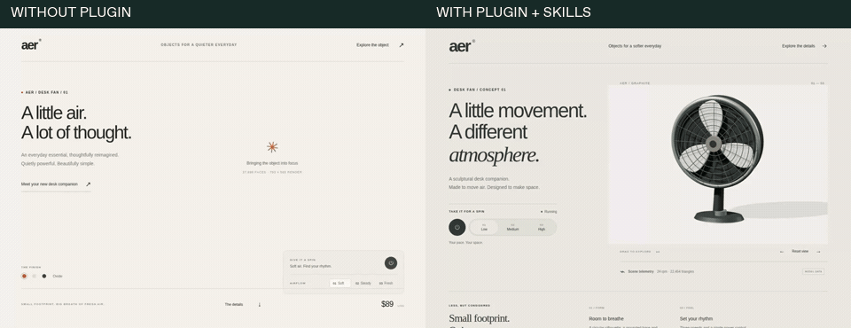
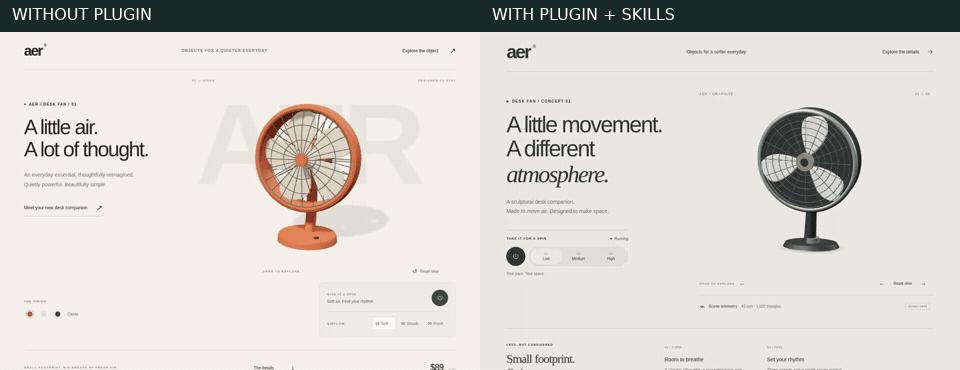

<p align="center"></p>

**Design, build and debug moving interfaces with your coding agent.**

Four focused skills guide visual design, real 3D UI and an evidence-led repair loop. A local MCP server gives the agent recorded frames and temporal measurements from the page it actually built.

[Setup](docs/CLIENTS.md) · [Skills](docs/SKILLS.md) · [Workflow DAG](docs/WORKFLOW.md) · [Demo](docs/DEMO.md)

## Install

Private preview · Node.js 22+ · no model API key

```sh
npm install -g ./motion-debugger-0.4.0.tgz
motion-debugger init --local
```

Choose your client and project. The wizard previews the MCP configuration and all four skills before writing anything. Chromium is an explicit download. Existing settings are preserved; conflicting skills are refused.

Supports **Codex, Claude Code, Cursor and VS Code/Copilot**. [Scripted setup →](docs/CLIENTS.md)

The repository remains private and the package is not on npm. Use the supplied tarball; there is no public `npx` package to assume exists.

## Give it a real task

> Use motion-build-inspect-repair to build a premium product page with an interactive 3D hero. Inspect its motion, repair observed problems and show the before/after evidence.

- **Design:** brief-led typography, layout, surfaces and complete interaction states
- **3D:** procedural scenes, camera, lighting, responsive controls and reduced motion
- **Observe:** real recordings, native image frames, events and explicit contracts
- **Repair:** the host agent edits source, repeats the interaction and compares the result

`motion_capture` → `motion_inspect` + `motion_frames` → agent source edit → `motion_compare`

The [workflow is an explicit DAG](docs/WORKFLOW.md): brief → design → build → inspect → repair 1 → verify 1 → repair 2 → verify 2 → report, with early-pass and blocker exits. No unbounded retry loop.

## See it work

### Current drawer-repair demo

The [drawer continuity case](cases/aer-drawer-continuity/README.md) repairs the saved page's abrupt dialog close and preserves its current pose during rapid keyboard reopening. From a source checkout, run:

```sh
npm run demo:repair
```

Open the printed loopback address for the live before/after pages and source-matched recordings when local evidence is present. [CI run 37071618067](https://github.com/ShadowKingYT444/motion-debugger/actions/runs/37071618067) passed browser, lifecycle and fresh-package verification for source [`59511589a28bc10bd336985e8220dcf4e3d332a5`](https://github.com/ShadowKingYT444/motion-debugger/commit/59511589a28bc10bd336985e8220dcf4e3d332a5); its [browser evidence artifact](https://github.com/ShadowKingYT444/motion-debugger/actions/runs/37071618067/artifacts/11255585567) contains the recordings and reports.

Functional passes do not override failed cadence assertions or inconclusive temporal comparisons on software-rendered runners. The unchanged 80ms integrity gate still applies. See the [evidence architecture and timing limits](docs/EVIDENCE-ARCHITECTURE.md). This supplemental source repair establishes no aesthetic or agent-winner advantage.

### Historical AER study: separate generation

The [AER case study](studies/aer/README.md) started two independent agents from the same product brief, each generating its own initial source. The historical videos below belong to that separate-generation study; they are neither the requested [same-start repair ablation](studies/shared-start-aer/) nor the current drawer-repair demo. Initial source, agent-written repairs and actual browser evidence are preserved. It is one paired example, not a general benchmark.

#### Historical initial A/B outputs



Full initial MP4s: [without plugin](https://github.com/ShadowKingYT444/motion-debugger/raw/refs/heads/release/v0.3/docs/assets/aer/baseline-initial.mp4) · [with plugin + skills](https://github.com/ShadowKingYT444/motion-debugger/raw/refs/heads/release/v0.3/docs/assets/aer/treatment-initial.mp4)

#### Historical outputs after evidence-led repairs



Full repaired MP4s: [without plugin](https://github.com/ShadowKingYT444/motion-debugger/raw/refs/heads/release/v0.3/docs/assets/aer/baseline-final.mp4) · [with plugin + skills](https://github.com/ShadowKingYT444/motion-debugger/raw/refs/heads/release/v0.3/docs/assets/aer/treatment-final.mp4)

Animated previews play here; MP4 links download the full recordings. Both agents repaired real issues. This single pair does not establish a general plugin advantage, and normal-motion sampling remains inconclusive on the software-rendered runner. [Results, capture IDs and continuation limits →](studies/aer/RESULTS.md)

Run `npm run demo:study` from the source checkout to explore the actual saved pages. The smaller seeded fixtures remain available with `motion-debugger demo`.

## Honest boundaries

Use trusted, credential-free local previews. Captures interact with the page and are not automatically redacted. A canvas rectangle cannot prove its internal animation is smooth; inspect the recorded frames. Skills guide the host agent rather than supplying a separate model or repair oracle.

[Development](CONTRIBUTING.md) · [Security](SECURITY.md) · [Verification](docs/V4-VERIFICATION.md) · [Taste attribution](plugin/motion-debugger/skills/motion-design/references/taste-provenance.md)
