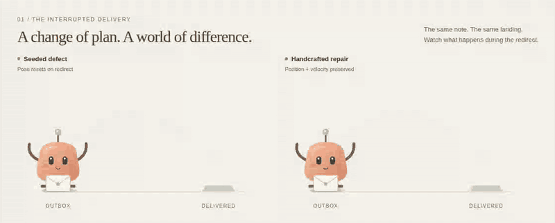

<p align="center"></p>

**Design, build and debug moving interfaces with your coding agent.**

Four focused skills guide visual design, real 3D UI and an evidence-led repair loop. A local MCP server gives the agent recorded frames and temporal measurements from the page it actually built.

[Setup](docs/CLIENTS.md) · [Skills](docs/SKILLS.md) · [Workflow DAG](docs/WORKFLOW.md) · [Demo](docs/DEMO.md)

## Install

Private preview · Node.js 22+ · no model API key

```sh
npm install -g ./motion-debugger-0.4.0.tgz
motion-debugger init --local
```

Choose your client and project. The wizard previews the MCP configuration and all four skills before writing anything. Chromium is an explicit download. Existing settings are preserved; conflicting skills are refused.

Supports **Codex, Claude Code, Cursor and VS Code/Copilot**. [Scripted setup →](docs/CLIENTS.md)

The repository remains private and the package is not on npm. Use the supplied tarball; there is no public `npx` package to assume exists.

## Give it a real task

> Use motion-build-inspect-repair to build a premium product page with an interactive 3D hero. Inspect its motion, repair observed problems and show the before/after evidence.

- **Design:** brief-led typography, layout, surfaces and complete interaction states
- **3D:** procedural scenes, camera, lighting, responsive controls and reduced motion
- **Observe:** real recordings, native image frames, events and explicit contracts
- **Repair:** the host agent edits source, repeats the interaction and compares the result

`motion_capture` → `motion_inspect` + `motion_frames` → agent source edit → `motion_compare`

The [workflow is an explicit DAG](docs/WORKFLOW.md): brief → design → build → inspect → repair 1 → verify 1 → repair 2 → verify 2 → report, with early-pass and blocker exits. No unbounded retry loop.

## See it work

The [AER case study](studies/aer/README.md) starts two independent agents from the same product brief. Initial source, agent-written repairs and actual browser evidence are preserved. It is one paired example, not a general benchmark.

### Recorded initial A/B outputs


Watch the full recordings: [without plugin](docs/assets/aer/baseline-initial.mp4) · [with plugin + skills](docs/assets/aer/treatment-initial.mp4) · [repaired baseline](docs/assets/aer/baseline-final.mp4)

These are real Chromium recordings. The five-second preview uses the same playback speed, with labels and resizing only. Read the study report for cadence limitations and repair history.

The smaller bundled fixtures remain available with `motion-debugger demo`:



Those fixtures intentionally contain seeded defects and handwritten repairs; they test the evidence tools.

## Honest boundaries

Use trusted, credential-free local previews. Captures interact with the page and are not automatically redacted. A canvas rectangle cannot prove its internal animation is smooth; inspect the recorded frames. Skills guide the host agent rather than supplying a separate model or repair oracle.

[Development](CONTRIBUTING.md) · [Security](SECURITY.md) · [Verification](docs/V3-VERIFICATION.md) · [Taste attribution](plugin/motion-debugger/skills/motion-design/references/taste-provenance.md)
