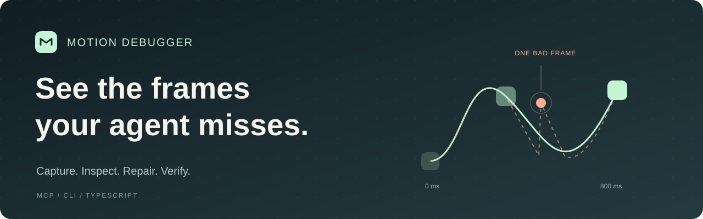

# Motion Debugger



**Create expressive web motion. Watch the actual result. Refine it with your coding agent.**

Tag `motion` with your ordinary website or app prompt. The plugin supplies six original runnable recipes—interruptible springs, scroll chapters, articulated 3D colonies, task handoffs, elapsed task sequences and reversible drawers—plus design guidance and local browser tools. Positive journey outcomes, recorded images and temporal contracts keep functional completion, visual review and measurements separate. Your agent edits source using its normal tools.

[Quickstart](#quickstart) · [Client setup](docs/CLIENTS.md) · [Skills](docs/SKILLS.md) · [Tool examples](docs/AGENT-WORKFLOW.md)

## Real demos

The [Ants launch-page study](studies/ants-launch/README.md) contains two actual same-brief, twenty-minute Codex builds with original articulated 3D scenes, scroll choreography and a working four-stage task. Both complete the task, replay, interruption and keyboard journeys on desktop, mobile, reduced motion and WebGL fallback. Complete source-bound recordings and retained failures are included. This pair does **not** establish an overall animation or smoothness advantage.

```sh
npm run demo:ants
```

Open the printed local URL to interact with both frozen pages and watch complete recordings. The viewer verifies source and recording hashes, supports narrow-screen previews and fullscreen, and serves each page on its own origin. Read the [method](studies/ants-launch/METHOD.md) and [results](studies/ants-launch/RESULTS.md). The six runnable creation modules are in the [motion catalog](plugin/motion-debugger/skills/motion/recipes/).

The [MONO workflow comparison](studies/workflow-mono-20261003/README.md) gives two independent agents the same demanding audio-product brief, GPT-6-Luna Max model and twenty-minute budget. One builds and refines with ordinary tools; the other uses Motion's installed skills and actual MCP tools. The recordings show matched visitor journeys through their independently built sites.

- [Ordinary workflow: full recording](docs/assets/workflow-mono-20261003/control.mp4)
- [Motion workflow: full recording](docs/assets/workflow-mono-20261003/treatment.mp4)
- [Prompt, source, tool traces and findings](studies/workflow-mono-20261003/README.md)

**Result:** Motion made an evidence-led easing repair, but this trial did not demonstrate a better overall site. Its Undo control failed and both final recordings had weak temporal sampling. The later GPT-6.1 follow-up is [preserved for handoff](handoffs/motion-local-20261003/README.md); it did not reach a verified final comparison.


This compares complete workflows, including Motion's bundled guidance. It does not isolate a tool's causal effect or establish a general coding-agent advantage. Function checks, contract results and visual observations are reported separately.

## Quickstart

Private release candidate. Requires Node.js 22+ and a Chromium browser. No model API key is required by this tool. Version `0.5.0` is **not published on npm**.

From this reviewed checkout:

```sh
npm ci
npm run build
node build/cli/index.js doctor
node build/cli/index.js init --client codex --local --skills \
  --project /absolute/path/to/your-app
```

`init` previews the exact project configuration and five skill folders. Review the output, then rerun with `--apply` and approve the preview. In a noninteractive terminal, use its exact `--confirm <confirmationToken>`. Existing unrelated settings and skills are preserved. If `doctor` reports no browser, run `node build/cli/index.js setup --browser`, then run `doctor` again.

For a portable installation, run `npm pack`, install the resulting local tarball into a stable tools directory, and use its `motion-debugger` binary. [Full installation options](docs/CLIENTS.md).

Then ask your agent:

> $motion Build a beautiful launch page for a colony of helpful agents, with an interactive spatial hero, a working task demonstration, and polished transitions.

For an existing app, include its preview URL and the behavior you want improved. For portable Codex, Claude Code, Cursor and generic skill packages, run `npm run package:plugins` after building. [Package formats, local installation and validation limits](docs/PLUGIN-PACKAGES.md).

Use a trusted, credential-free production preview. Motion blocks WebSockets, including development-server HMR.

## Capture → inspect → repair → verify

| Tool | What the agent receives |
| --- | --- |
| `motion_recipe` | Original runnable source, dependencies and integration/evidence guidance by recipe ID |
| `motion_capture` | WebM recording, screenshots, events, measurements and explicit contract results |
| `motion_inspect` | A bounded time window with relevant events and samples |
| `motion_frames` | PNG frames from the actual recording; whole-journey selection and detail bounds up to 1280×960 |
| `motion_compare` | Before/after changes, comparability checks and final-state equivalence |
| `motion_list` | Saved captures in the configured evidence directory |

Choose a unique target, repeatable actions and meaningful positive outcome expectations before the repair. `contract.outcomes` can require result text, visibility and state attributes and reject visible error states within a deadline. Missing outcomes produce `delivery.status: unverified`; a stable canvas cannot establish that a task completed. Keep the same viewport, actions and contracts afterward. The [agent walkthrough](docs/AGENT-WORKFLOW.md) shows calls; the [workflow](docs/WORKFLOW.md) bounds each repair investigation.

Each capture produces:

```text
.motion-evidence/<capture-id>/
├── video.webm     actual browser recording
├── poster.png    starting page
├── final.png     final page
└── report.json   recipe, trace, findings and limitations
```

## Agent integrations

Project setup supports **Codex, Claude Code, Cursor and VS Code/Copilot** through the same local stdio MCP server. Replace `codex` in the setup command with `claude-code`, `cursor` or `vscode`.

Fresh tarball installation, the official MCP SDK connection, real tool calls, browser captures and all four configuration formats are tested. Portable Codex, Claude Code and Cursor ZIPs also have fresh dependency and SDK checks. Actual interactive compatibility is reported separately in [client evidence](docs/CLIENTS.md).

## Scope and limits

- Capture only trusted local pages. Recordings are not automatically redacted; no personal browser profile is imported.
- Measurements evaluate your stated contracts. They are not an aesthetic score or proof of perceptual smoothness.
- Weak sampling is inconclusive. The unchanged 80 ms integrity gate must pass before temporal comparisons can establish an improvement.
- A canvas rectangle cannot reveal motion inside a 3D scene. Inspect video frames as well as measurements.
- Source references and app marks are supplied annotations, not causes inferred from pixels.

[Development and tests](CONTRIBUTING.md) · [Security](SECURITY.md) · [Evidence architecture](docs/EVIDENCE-ARCHITECTURE.md) · [Historical studies](studies/aer/README.md) · [Design attribution](plugin/motion-debugger/skills/motion-design/references/taste-provenance.md)
