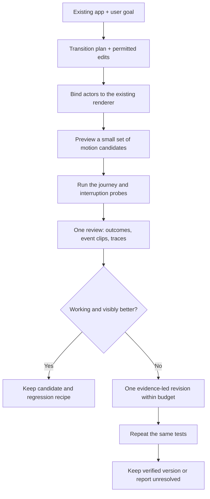

# Motion Debugger: from different styling to measurable motion value

Status: research and implementation proposal. No runtime upgrade or new agent benchmark is implemented by this PR.

Audited on 2026-10-04 at `main` commit `6887824e3a3d64e8a8702615a88072ff2b968410`, after the production-motion merge. The audit used current source, the frozen LOOP study, its recorded tool requests, and the supplied comparison screenshot. It did not rerun the agents or independently play the full recordings. Statements about earlier browser results are attributed to their stored reports. Preserve the completed Ants diagnosis and all historical evidence.

## 1. Decision

Do not build another independently styled landing-page pair to demonstrate superiority. Build a **motion authoring and review layer for an existing design**. Its job is to help a coding agent coordinate moving objects, respond correctly to interruption, and improve the visible sequence without replacing the user's composition.

The proposed advantage is specific: turn a request such as “keep the selected part easy to follow while the product opens, changes, and closes” into editable motion decisions and a short, repeatable review. This needs information about the moving parts and their timing, not only screenshots of the page or the rectangle around its canvas.

The product must also help create good motion, not just reject bad motion. Add an editable transition plan, renderer-specific bindings, bounded candidate previews, and event-linked evidence. Reuse existing animation engines. Prove whether this combination improves results against strong ordinary agents and official animation skills. This is a hypothesis to test, not a claim of an established market gap or a guaranteed win.

The proposed flagship is **ASSEMBLY: one camera, one design, two motion implementations**. Its complete prompt, evaluator rules, demonstration sequence, and launch gates are in [the demo protocol](ASSEMBLY-DEMO-PROTOCOL.md). The [machine-readable protocol](assembly-demo.protocol.json) is intentionally not runnable until its missing inputs are frozen.

## 2. What the latest repository actually establishes

### Existing capabilities to keep

The current release already has five skills, seven editable recipes, positive `contract.outcomes`, real recorded images, whole-journey frame selection, source-bound evidence, installation previews, and a bounded repair workflow. Proposing these as missing would repeat work already completed. [R1], [R7], [R12], [R13]

The production kinetic-field recipe already preserves spring state across target changes. It has stable point IDs, pause, resume, explicit direct seeking, reduced-motion poses, and renderer-error recovery. The proposed upgrade must not replace this with another generic spring implementation. [R8]

### What LOOP demonstrates, and what it does not

The stored report says both independently generated sites pass the main desktop, mobile, reduced-motion, fallback, replay, pause, and export checks. It explicitly establishes no overall aesthetic or smoothness winner. It reports ordinary generation at 26m59s and assisted generation at 22m53s, but one pair does not establish a repeatable speed advantage. [R2], [R3]

There is a real motion difference: the report describes ordinary crossfading between compositions and Motion retargeting a persistent capsule formation. The source supports the mechanism distinction: the assisted app uses 48 capsule instances and a kinetic controller; the ordinary app constructs toruses, SVG patterns, and style-specific elements. Neither mechanism implies better composition or perceptual quality. [R3], [R10], [R11]

The screenshot is compatible with a preference for the ordinary version's materials, shadow, and composition. It cannot establish frame pacing, responsiveness, or transition continuity. Keep that preference as design feedback, not a temporal measurement.

### Root causes supported by the audit

| Finding | Concrete evidence | Consequence |
| --- | --- | --- |
| The demonstration changes too many things | Independent outputs use different geometry, lighting, layout, and motion structure. [R3], [R10], [R11] | A viewer cannot attribute a preference to the motion tooling. Same starting files before generation do not make the resulting compositions controlled. |
| The measured target is too coarse | The first audited LOOP capture selects `#specimen`. Its contract checks continuous target presence, replacements, and final selected/playing controls. The probe samples one DOM target. [R4], [R9] | A canvas can stay in place while internal objects jump, intersect, drift, or become hard to follow. Passing these checks cannot establish good internal motion. |
| The strongest existing signals are not a design objective | `analysis.ts` measures displacement, interval-average velocity, height, opacity, containment, and evidence integrity. Its own labels reject a smoothness interpretation. [R5] | Reducing displacement can reward slow or nearly absent motion. A bounded speed is not purposeful staging or a satisfying response. |
| Temporal coverage remains weak | LOOP reports 17 MCP calls, 30 returned PNGs, and two inconclusive temporal comparisons. The reported films are 25fps VP8 on software-rendered Chrome. [R2], [R3] | More calls and frames are not evidence of better decisions. These recordings do not certify 60fps presentation. |
| Frame selection is not tied to the intended beat | `frameTimes()` chooses a finding window or six evenly spaced journey times. `recordedFrames()` documents approximate host-offset alignment. [R6] | A handoff, reversal, or short reset can fall between selected images. Larger images alone do not solve this. |
| Guidance is mostly a host plan | The skill already asks for a motion story, real controls, useful frames, and functional-first repair. The DAG validates structure, not host execution or quality. [R7], [R12] | Repeating those instructions is unlikely to create a new capability. The agent needs cheaper, more diagnostic feedback and concrete editing controls. |

These are different problems. Improving the benchmark does not itself improve the plugin. Improving the recorder does not itself supply taste. All three layers—construction, observation, and evaluation—need an explicit role.

One important boundary: LOOP used an immutable earlier intervention package. Later production repairs were not substituted into its frozen endpoints. Use that study to identify weaknesses, not to claim that every current recipe still has an old failure. [R2], [R3]

## 3. Public alternatives set a higher bar

The following are capabilities described by their maintainers as accessed on 2026-10-04. They are not independent performance comparisons.

| Existing option | Relevant capability | Implication for Motion Debugger |
| --- | --- | --- |
| Motion AI Kit | Official animation skill and documentation search; paid examples and local render-cost profiling; CSS spring generation. [S1] | “An animation skill with recipes and performance advice” is not a sufficient distinction. Test against the free official skill, and do not claim comparison against paid features that were not tested. |
| Official GSAP skills | Agent guidance for GSAP, timelines, plugins, and framework integration. [S2] | Give the ordinary agent current library knowledge, not a deliberately weak prompt. |
| Chrome DevTools MCP | Browser debugging, screenshots, and performance tracing for coding agents. [S3] | A browser connection or performance trace alone is not the advantage. |
| Playwright CLI | Agent-accessible browser actions, selectors, screenshots, and testing workflows. [S4] | Ordinary revisions must retain real browser access. Measure the cost of the added workflow. |
| Existing animation engines | Motion physics springs incorporate existing velocity; GSAP Flip manages DOM layout transitions, including interruption concerns. [S5], [S6] | Adapt proven engines instead of rebuilding their primitives. Flip is not a general 3D transform solver. |
| Chrome Animations panel | Timeline inspection for CSS, WAAPI, and related browser animations, but not arbitrary `requestAnimationFrame` animation. [S7] | A cross-renderer, user-journey review is a candidate focus. Do not advertise ordinary timeline scrubbing as a new invention. |

A useful research precedent is Heer and Robertson's work on animated transitions in statistical graphics. It treats correspondence and staged transitions as design problems, with controlled perception experiments. Its chart results do not prove that a staged camera animation will be preferred. The transferable idea is to test whether viewers can follow a meaningful change, rather than treating more movement as better. [S8]

## 4. Proposed technical architecture

All names and schemas in this section are proposed. They are not available commands in v0.5.0.

### 4.1 An editable transition plan, not another style prompt

Represent one meaningful transition as structured data. The host agent derives it from the normal brief and existing app. Users should not have to author a graph. Store:

- **Actors:** stable logical identities, renderer binding, relevant source locations, and which visual attributes must remain unchanged.
- **Beats:** trigger, initial pose, intermediate purpose, destination, relative order, and allowed overlap. Examples: make space; move the selected lens; attach its label; settle.
- **Input policy:** what an interruption means, which action wins, and which position or velocity must carry into the next transition.
- **Acceptance:** useful completion, visible error exclusions, response and settling limits, reduced-motion behavior, and protected design properties.

Keep a transition's phase dependencies acyclic. The application's state machine can still contain cycles such as open/close/reopen. Do not confuse a bounded agent workflow with the runtime interaction model.

The first schema should cover DOM/SVG transforms and an opt-in Three.js actor adapter. Exclude arbitrary physics simulation and automatic asset rigging. Resolve relative DOM positions at transition start; invalidate bindings on viewport or scene changes. Use CSS pixels for projected screen positions, radians for orientation, and explicit clocks and coordinate spaces.

Start with three editable construction patterns: persistent-object handoff, staged spatial decomposition, and drag-release settling. These are patterns, not new full-page templates. They must accept the user's own objects, materials, camera, labels, and state.

The difference from a generic recipe is the information retained for review. The tool should know *which object should remain trackable and when it should arrive*, not only which easing function was used.

### 4.2 Bind observations to the things that move

Extend the current single-target capture with a bounded actor set. An initial engineering limit of eight DOM actors and sixteen scene actors is a proposal to profile, not a browser standard.

For DOM/SVG, retain logical and physical node identity, transform, bounds, visibility, and relevant animation operations. For Three.js, use an explicit registration adapter for selected objects and the active camera. After the consumer's render step, copy world transform, camera matrices, projected anchor/bounds, and render timestamps into a bounded buffer. Do not require a second animation scheduler.

Classify evidence correctly:

| Evidence | What it can support | What it cannot support |
| --- | --- | --- |
| Browser-observed DOM geometry and events | Input ordering, element state, measured geometry | Internal WebGL object position |
| App-adapter scene state | Intended pose, identity mapping, source hypotheses | Independent proof that the object was actually painted there |
| Recorded native pixels with timing limits | Visible overlaps, framing, rendered transitions | More temporal precision than the recording contains |
| Browser trace and renderer identity | Work and scheduling diagnosis | Universal aesthetic quality or unmeasured physical-device performance |

Pair scene annotations with pixel checks. A development fixture should deliberately report a smooth pose while rendering a jump; the review must not turn the annotation into a pass. Optional object-ID renders or masks belong in a separate diagnostic run, because their extra rendering changes cost. Do not add synchronous per-frame pixel reads to the performance path.

Stable identity is not always the right visual policy. Some scenes legitimately crossfade between unrelated objects. Enforce identity continuity only where the brief requires a viewer to follow the same part.

### 4.3 Return one useful review packet

Add a high-level `motion_review` operation, plus an equivalent CLI path. Reuse capture, inspection, and frame code internally; keep the low-level tools for focused investigation. The review should accept a transition plan, replayable journey, evidence budget, and optional prior capture.

Return a compact summary first: primary outcome, failed or unverified transitions, the most useful next inspection, and links to a bounded evidence packet. Cache decoded frames by capture hash and request. Do not launch a new decode browser for every requested crop when one bounded session can serve the review.

For each flagged transition, include the input event, visible actor, time window, relevant actual frames, measured quantities with units, source candidates, and one falsifiable repair hypothesis. A source map or app mark is a hint, not proof of causation. Show a competing explanation when the trace cannot distinguish an application reset from a weak recording.

Frame selection should cover trigger, maximum displacement or overlap, interruption, handoff, and arrival. Use short event-centered bursts when cadence supports them. Return whole-page context and a detail crop rather than six evenly spaced images by default. Preserve requested time, decoded presentation timestamp when available, and alignment uncertainty. Do not call a requested seek position the exact originating frame time.

Retain a short playable clip for the human. For hosts that cannot consume video, return ordered contact sheets and selected native frames. Log which bytes were delivered. Neither a tool call nor a written “I inspected it” statement proves that the model perceived the sequence correctly.

Separate two modes. **Pose preview** can use controlled time for authoring. **Native replay** uses real input, real clocks, and real rendering for timing claims. Pose preview results must never be relabeled as FPS or interaction-latency evidence.

### 4.4 Make interruption testing cheap and reproducible

Move from a single happy-path recording to bounded transition probes. Generate a small grid of interruption offsets around a transition, then refine neighborhoods that show failures. Do not assume failures vary monotonically with the offset. Record requested and browser-observed event times.

Support rapid retargeting, reverse scroll, pointer cancellation, keyboard activation, resize, and reduced-motion changes where relevant. Restore the same starting state between attempts. Minimize a reproducible failure into a small action sequence. Keep nondeterministic failures and infrastructure failures separately labeled.

The result the agent needs is concrete: “This open/reverse/open sequence loses the selected object during the second handoff,” with the source state, recipe, and visible evidence attached. It should not require manually assembling seventeen tool calls just to discover that the capture window was too short.

### 4.5 Evaluate motion intent, not a universal smoothness number

Retain existing integrity checks and the 80ms rejection gate. Passing that gate is not a 60Hz or 120Hz quality certificate. Add separate transition-specific observations:

| Question | Proposed measurement and safeguard |
| --- | --- |
| Does the response follow the user's input? | Actual input-to-observed-change interval, with its observation method and uncertainty. Do not equate callback time with pixel presentation. |
| Does interruption reset the object? | Position discontinuity around retargeting, adjusted for actual sample spacing. Distinguish a state reset from ordinary travel during a gap. |
| Is velocity preserved where intended? | One-sided velocity estimates near the event, only with adequate samples and a declared continuity policy. Never require this for explicit direct scrubbing or an intentional cut. |
| Does the motion arrive? | Time within destination tolerances, required travel or intermediate coverage, and final useful state. This prevents a nearly frozen animation from winning. |
| Can a viewer follow the selected part? | Identity/visibility evidence plus a small human tracking task. A trajectory metric alone cannot answer this. |
| Does one element obscure another important element? | Time-windowed projected overlap as a warning, checked against actual pixels. Projected rectangles are not a full occlusion oracle. |
| Is playback expensive? | Native browser work and frame-interval distributions on a named device, with instrumented and uninstrumented runs. Distinguish recorder cadence from display presentation. |

Do not optimize raw jerk as a quality score. Higher-order differences amplify sample noise, and deliberate impacts can require abrupt acceleration. Use continuity as a stated design contract, not an aesthetic law.

The current probe collects long tasks. Add feature-detected Long Animation Frame observations for rendering-related diagnosis and available script attribution. LoAF covers updates over 50ms and excludes presentation time from its duration; it does not detect every missed 16.7ms frame or certify GPU smoothness. Preserve unsupported status on other runtimes. [R4], [S9]

### 4.6 Give the agent a constrained creation loop

Expose bounded motion parameters: pose/path, phase overlap, travel duration, spring response, label handoff, and camera transition. The host applies edits with normal coding tools. Protect layout, assets, copy, materials, and public interactions unless the task explicitly permits changing them.

For one transition, build up to three candidates within the same total budget: the current version, a minimal revision, and an alternative staging. Compare a short native journey before applying the winner to the full app. Candidate rendering, review, and failed attempts all count toward cost.

Reject functional failures first. Then compare motion meaning, response, trackability, and visual preference separately. Do not collapse them into a single unexplained “taste score.” A model critic may nominate a candidate, but must cite event/frame evidence and may abstain. Calibrate it against blinded human judgments before using it as the main selector. The current two-repair bound remains a default safety limit, not a theory that exactly two edits is optimal.

Example: every part moving at once may be numerically continuous but visually hard to follow. A candidate can hold the body, move the selected lens, then bring in its label while secondary parts settle. That is a testable staging alternative. It is not automatically better: it loses if it makes the response slow or hides relevant information.

Save successful motion configurations with their app/actor bindings and regression recipe. Do not grow an unfiltered library of full-page styles. A reusable pattern should explain when it helped and which constraints it satisfied.

## 5. Implementation sequence and acceptance tests

Suggested new paths below are implementation targets, not files created by this research PR.

| Slice | Main code locations | Must pass before moving on |
| --- | --- | --- |
| A. Measurement calibration | Extend `packages/core/types.ts`, `browser-probe.ts`, `coverage.ts`, `analysis.ts`; add actor-adapter tests | Detect a visible internal-scene jump with stationary canvas bounds. Reject spoofed annotations. Keep legitimate fast movement and direct scrubbing as negative controls. Preserve old reports and thresholds. |
| B. Transition plan and bindings | New `packages/core/transitions.ts`; adapter modules next to existing recipes; catalog integration | Serialize and validate units, phase dependencies, logical IDs, input policy, and missing bindings. Consume existing springs/engines. No dependency on a fixed capsule style. |
| C. Review and replay | Extend `capture.ts`, `frames.ts`, `packages/mcp/server.ts`, and CLI; new replay/review modules | Generate bounded event evidence and a repeatable small failure case. Keep clocks, source hashes, renderer identity, and error states. Cancel cleanly. Avoid silent retries and uncontrolled output growth. |
| D. Authoring workflow | Update the existing motion skill and workflow validator; retain historical study inputs | Keep protected design bytes unchanged. Produce meaningful motion candidates, an evidence-backed selection or abstention, and the last verified checkpoint. Measure tool/decoding cost. |
| E. Packaging and evaluation | Existing client/package tests; separate benchmark runner and frozen task inputs | Actual clean native Codex and Claude Code sessions discover the intended package, call the tools, receive images, and complete a named task. Compare against strong ordinary workflows. |

Do not start a large agent sweep before slice A can measure its own known fixtures. A detector-development fixture may contain a deliberately seeded defect, but it must remain labeled and separate from a blinded agent task.

For each runtime slice, run the repository checks, relevant native browser suites, and an independent packed install. Test the legacy tools and new review entry together. New reports need explicit schema/capability versions and a defined compatibility policy. Historic evidence must not be silently recomputed as if it came from the new probe.

## 6. What qualifies for launch

There are two different releases: a usable plugin preview, and a superiority claim. Neither requires pretending the other is finished.

A usable preview needs verified host discovery, safe installation/uninstallation, bounded capture, useful error messages, protected user files, and at least one complete author/review workflow. Current docs establish actual Codex project-skill/MCP sessions, while interactive Claude Code and some native package discovery remain unverified. Close those exact gaps rather than counting generated config files as host verification. [R13]

Keep the local-only security model, origin restrictions, explicit source roots, and normal host approval. Trace tools must not connect to a personal browser profile, upload app data, or enable optional telemetry silently. A dependency audit must check telemetry and external services. Test coexistence with other animation skills; the public Motion kit also uses a `/motion` entry, so a namespaced entry needs explicit collision tests. [R13], [S1], [S3]

A superiority claim needs repeated same-source trials, functioning outputs, blinded motion review, named hardware, and a comparison with current ordinary tools. The [protocol](ASSEMBLY-DEMO-PROTOCOL.md) defines an initial pilot, not a statistically sufficient general benchmark. Use its results to set the confirmatory sample size and freeze a separate holdout before further tuning. Agent evaluation should test the resulting app, not reward a mandatory tool sequence. [S10]

Reduced motion and pause are product requirements, not optional penalties in a visual score. WCAG distinguishes user-triggered nonessential animation from certain automatically moving content. These controls do not by themselves certify full accessibility conformance. [S11], [S12]

If the new plugin does not beat the strong baseline, inspect the ablations. If it only reduces verification work, launch it as a motion review/regression tool with that evidence. If creation adds no benefit, do not market it as an automatic animation-quality upgrade. Do not cherry-pick another blue hero until the claim looks true.

## 7. Evidence and research references

Repository references are pinned to the audited commit. Proposed architecture and demo thresholds above are engineering judgments, not reported experimental results.

[R1]: https://github.com/ShadowKingYT444/motion-debugger/blob/6887824e3a3d64e8a8702615a88072ff2b968410/README.md
[R2]: https://github.com/ShadowKingYT444/motion-debugger/blob/6887824e3a3d64e8a8702615a88072ff2b968410/studies/loop-studio/METHOD.md
[R3]: https://github.com/ShadowKingYT444/motion-debugger/blob/6887824e3a3d64e8a8702615a88072ff2b968410/studies/loop-studio/RESULTS.md
[R4]: https://github.com/ShadowKingYT444/motion-debugger/blob/6887824e3a3d64e8a8702615a88072ff2b968410/packages/core/browser-probe.ts
[R5]: https://github.com/ShadowKingYT444/motion-debugger/blob/6887824e3a3d64e8a8702615a88072ff2b968410/packages/core/analysis.ts
[R6]: https://github.com/ShadowKingYT444/motion-debugger/blob/6887824e3a3d64e8a8702615a88072ff2b968410/packages/core/frames.ts
[R7]: https://github.com/ShadowKingYT444/motion-debugger/blob/6887824e3a3d64e8a8702615a88072ff2b968410/plugin/motion-debugger/skills/motion/SKILL.md
[R8]: https://github.com/ShadowKingYT444/motion-debugger/blob/6887824e3a3d64e8a8702615a88072ff2b968410/plugin/motion-debugger/skills/motion/recipes/kinetic-field.mjs
[R9]: https://github.com/ShadowKingYT444/motion-debugger/blob/6887824e3a3d64e8a8702615a88072ff2b968410/studies/loop-studio/MCP-TRACE.json
[R10]: https://github.com/ShadowKingYT444/motion-debugger/blob/6887824e3a3d64e8a8702615a88072ff2b968410/studies/loop-studio/source/motion/app.js
[R11]: https://github.com/ShadowKingYT444/motion-debugger/blob/6887824e3a3d64e8a8702615a88072ff2b968410/studies/loop-studio/source/ordinary/app.js
[R12]: https://github.com/ShadowKingYT444/motion-debugger/blob/6887824e3a3d64e8a8702615a88072ff2b968410/docs/WORKFLOW.md
[R13]: https://github.com/ShadowKingYT444/motion-debugger/blob/6887824e3a3d64e8a8702615a88072ff2b968410/docs/CLIENTS.md
[S1]: https://motion.dev/ai-kit
[S2]: https://github.com/greensock/gsap-skills
[S3]: https://github.com/ChromeDevTools/chrome-devtools-mcp
[S4]: https://github.com/microsoft/playwright-cli
[S5]: https://motion.dev/docs/react-transitions
[S6]: https://gsap.com/docs/v3/Plugins/Flip/
[S7]: https://developer.chrome.com/docs/devtools/css/animations
[S8]: https://idl.uw.edu/papers/animated-transitions
[S9]: https://developer.chrome.com/docs/web-platform/long-animation-frames
[S10]: https://www.anthropic.com/engineering/demystifying-evals-for-ai-agents
[S11]: https://www.w3.org/WAI/WCAG22/Understanding/animation-from-interactions.html
[S12]: https://www.w3.org/WAI/WCAG22/Understanding/pause-stop-hide.html

[R1] Current product and tools. [R2] Frozen study method. [R3] Stored results and limits. [R4] Browser probe. [R5] Analyzer. [R6] Frame extraction. [R7] Construction skill. [R8] Current kinetic controller. [R9] Actual MCP requests. [R10] Assisted app. [R11] Ordinary app. [R12] Declarative workflow. [R13] Client verification limits.

[S1] Motion's product description. [S2] GSAP's official skills. [S3] Chrome DevTools MCP. [S4] Microsoft's Playwright CLI. [S5] Motion transition semantics. [S6] GSAP Flip capabilities and caveats. [S7] Chrome's animation inspector scope. [S8] Heer and Robertson, 2007, DOI 10.1109/TVCG.2007.70539; chart-transition research, not a web-plugin benchmark. [S9] Chrome's LoAF documentation. [S10] Anthropic's agent-evaluation guidance, 2026-01-09. [S11], [S12] W3C's informative explanations of the named WCAG criteria.
