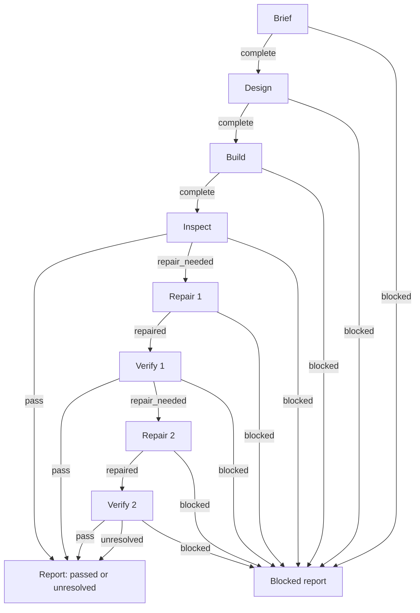

# Bounded build → inspect → repair workflow

Motion Debugger's workflow is a directed acyclic graph (DAG). Repetition is a new numbered node, so repair 2 and verify 2 are explicit rather than a loop back to repair 1. The host coding agent implements and repairs the page; Motion Debugger supplies design guidance and real local motion evidence. This is a declarative host-agent plan, not a new runner or orchestrator.

1. **Brief, design, build:** fix the requested behavior, visual direction, stack, final state and relevant variants, then implement and start a trusted credential-free local preview
2. **Inspect:** capture the real interaction and relevant interruption, inspect a bounded finding window, and view actual recorded intermediate frames. Keep the original capture IDs
3. **Repair 1, verify 1:** apply a narrow, evidence-led source fix within the user's existing build/fix authorization. Retest the same recipe and contracts, compare with the original baseline, view after frames and check the final state
4. **Repair 2, verify 2:** if a justified defect remains, do one more explicit repair/retest pair. There is no third repair in this graph
5. **Report:** stop early when the requested behavior, relevant tests and meaningful unchanged contracts pass and the actual motion has been viewed. After verify 2, report any remaining defect as unresolved. Include the product/preview, changes, checks, all capture IDs and limits
6. **Blocked report:** from any work node, stop on an exact permission, environment, reproduction or evidence blocker. Say what action and target are blocked and what is needed next. Missing evidence or an unjustified repair hypothesis is not a pass

The repair nodes are autonomous within the user's authorized scope. They do not require another approval merely to continue an already requested build/fix. They also do not authorize unrelated installs, credentials, publication or production changes. The host applies its existing confirmation policy. A terminal report ends this plan; any subsequent continuation is a separate plan, not a hidden back edge.

## Shipped files and references

- Machine-readable graph: [`plugin/motion-debugger/workflows/build-inspect-repair.json`](../plugin/motion-debugger/workflows/build-inspect-repair.json)
- Dependency-free structural validator: [`plugin/motion-debugger/workflows/validate.mjs`](../plugin/motion-debugger/workflows/validate.mjs)
- Separate host opt-in instructions: [`plugin/motion-debugger/workflows/README.md`](../plugin/motion-debugger/workflows/README.md)
- Execution references: [`plugin/motion-debugger/skills/motion-build-inspect-repair/SKILL.md`](../plugin/motion-debugger/skills/motion-build-inspect-repair/SKILL.md), [`plugin/motion-debugger/skills/motion-design/SKILL.md`](../plugin/motion-debugger/skills/motion-design/SKILL.md), [`plugin/motion-debugger/skills/motion-3d-ui/SKILL.md`](../plugin/motion-debugger/skills/motion-3d-ui/SKILL.md), [`plugin/motion-debugger/skills/motion-evidence/SKILL.md`](../plugin/motion-debugger/skills/motion-evidence/SKILL.md)
- Graph and regression tests: [`tests/workflow.test.mjs`](../tests/workflow.test.mjs), run with `npm run test:workflow`

The root package includes `plugin/` and `docs/`; the graph, validator and opt-in instructions travel with the plugin. No graph-registration field or automatic host enforcement is claimed. The graph's skill paths are plugin-root relative and work in a standalone plugin directory.

The experimental skill inputs and A/B prompts remain frozen in the study record; the released workflow skill now explicitly routes through this bounded plan. This separate graph does not retroactively change those runs or establish improved agent quality. The validator proves node/edge consistency, reachability, acyclicity and a maximum of two repairs per path; it does not prove a host followed the plan or that a generated interface is correct.
