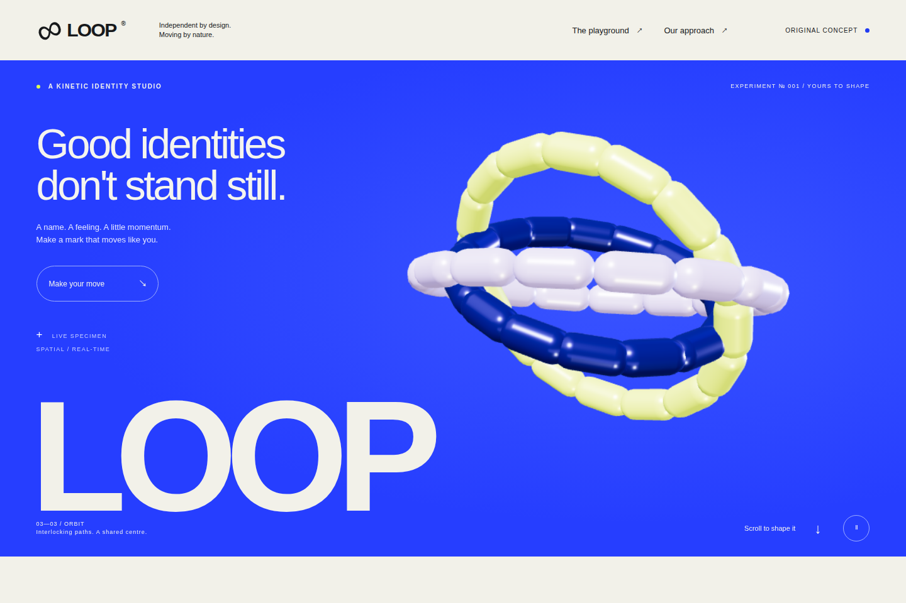

# LOOP kinetic identity studio

Motion is the product: create a name, choose Pulse/Weave/Orbit, tune its palette and energy, scrub through time, replay, then export your identity. The [same brief](BRIEF.md) went to two actual fresh native coding-agent sessions with identical starting inputs and thirty-minute budgets. Both finished. Only the assisted session received `$motion` and the installed plugin.

Both frozen builds complete the independent desktop/mobile/reduced/WebGL-fallback journeys and produce meaningful SVG/configuration exports. Exact native pause pixels and a corrected replay supplement accompany full original-timing films. This pair does **not** establish overall aesthetic or smoothness superiority. [Results](RESULTS.md) · [Source-bound verification](evidence/independent/ROLLUP.json) · [Retained failures](evidence/independent/FAILURES.json).

```sh
npm ci
npm run demo:loop
```

The local viewer fits both complete desktop compositions, supports 390px and native fullscreen previews, preserves working iframe downloads and verifies every frozen source/recording hash. Full recordings retain their original timing and framing.



[Ordinary desktop film](evidence/independent/primary/ordinary-desktop/journey.webm) · [Motion desktop film](evidence/independent/primary/motion-desktop/journey.webm). [All eight original films and hashes](STUDY.json).

Inspect the [source snapshots](source/), [reference observations](REFERENCES.md), [method](METHOD.md), [generation protocol](PROTOCOL.json), [preregistered expectations](HELDOUT-PROTOCOL.md), [actual tool responses](MCP-TRACE.json) and [30 returned native PNGs](evidence/tool-frames/INDEX.json). The trial's immutable initial plugin is separate from later production runtime refinements and their [release verification](../../docs/RELEASE-0.5.0.md).

The [Ants launch-page A/B](../ants-launch/README.md) and its original failures remain intact. LOOP adds a motion-centered editor where useful output and animation can be checked together.
