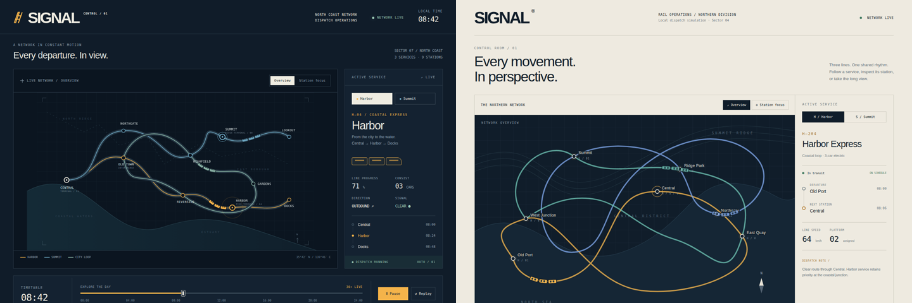

# SIGNAL / railway dispatch workflow A/B

Two independent agents built the same demanding motion interface from scratch: three articulated trains following curved routes, network/station camera transitions, service switching, a working timetable scrubber, pause/replay and JSON export. Both received the [same brief](BRIEF.md), an eight-minute wall-clock budget and inherited agent model/settings. Only one received Motion skills and actual MCP tools. The parent did not seed bugs or repair either app.

```sh
npm ci
npm run demo:rail
```

Open **http://127.0.0.1:4123**. Switch between live apps and recorded journeys; use **Restart both** to start the original recordings together. Desktop and mobile modes preserve each app's actual viewport. You can also open either app at full size.



[Ordinary desktop film](evidence/ordinary-desktop/journey.webm) · [Assisted desktop film](evidence/motion-desktop/journey.webm) · [Ordinary mobile film](evidence/ordinary-mobile/journey.webm) · [Assisted mobile film](evidence/motion-mobile/journey.webm)

## What the comparison shows

Both builders produced functioning, motion-heavy interfaces. The ordinary result uses a compact coastal network and an exponential camera approach. The assisted result uses larger interwoven routes and a persistent spring camera copied from a retrieved Motion recipe. Its lighter inspector and closer mobile camera create a different composition, but crop some outer stations; the ordinary mobile overview keeps more of its network visible. Compare station focus/reversal and timetable scrubbing in the films, then try the controls yourself.

The common checks passed on **desktop, mobile and reduced motion for both apps**: service selection, interruption/reversal, pause stability, timetable input, resume, replay, keyboard selection, export and absence of page errors/overflow. This verifies those journeys; it does not score aesthetics or prove that Motion produced better animation. No human preference winner is declared.

The ordinary app initially pauses under reduced motion. The assisted app retains running timetable state while using its reduced-motion presentation. The first harness incorrectly clicked Pause in both without inspecting initial state; that resumed the already-paused ordinary app. [Original reports and films](evidence/retained-harness-assumption/NOTE.md) remain available. The corrected harness establishes/retains paused state before checking the clock. Neither application changed.

## Method and evidence

Sources were frozen before independent recordings. The shared [browser runner](../../tests/rail-browser.mjs) records the same ordered visitor actions and waits in fresh Chromium contexts, with 1440×960 desktop and 390×844 mobile viewports. It keeps source hashes, exact per-arm event times, downloaded JSON, PNG hashes, native WebM hashes and browser version in [verification.json](evidence/verification.json). Scroll distance and action execution can differ between layouts; these are original-timing journeys, not synchronized simulation clocks.

Both implementations used the same inherited agent settings, with separate brief-only contexts and no access to the other arm. Exact provider-wire model identity and full native agent-host transcripts were not collected. This is a quick developer-agent workflow demonstration, not the planned eighteen-session campaign or a blind coding-agent benchmark.

The assisted builder made **one `motion_recipe`, three `motion_capture` and three `motion_frames` calls**, plus tool discovery through the official SDK and built stdio server. [Exact tool requests and responses](source/motion/evidence/capture-trace.json) · [Recipe trace](source/motion/evidence/recipe-trace.json) · [Guidance read and construction decisions](source/motion/evidence/WORKFLOW.md). The ordinary builder used ordinary source/browser tools. No Motion guidance was supplied to it.

Actual desktop/mobile screenshots and timed native-film frames were inspected. Browser rAF intervals passed the unchanged 80ms gate in these runs. That timing evidence is not a measurement of physical display FPS or per-train painted continuity. Individual actor response/velocity contracts, blind preference, multi-run reproducibility and general superiority remain unverified. Both inspectors contain illustrative timetable copy.

## Reproduce

```sh
npm run test:rail:browser
```

Browser campaigns should run serially. The runner retains failures in reports; a failed check never becomes a hardcoded passing result. CI also runs the common journeys. The current recordings are local runs; remote CI status is reported separately.
